

  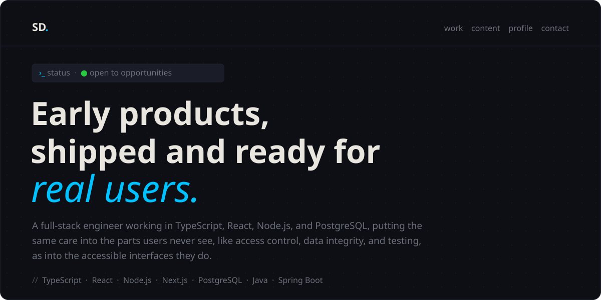

  
  
  <a href="https://iamsanjeebandas.com/work">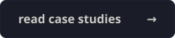</a>

 

 

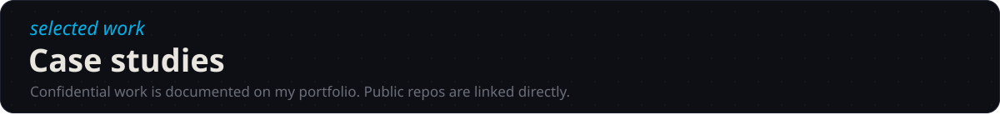

  <a href="https://iamsanjeebandas.com/work/automotive-dealer-assessment-platform">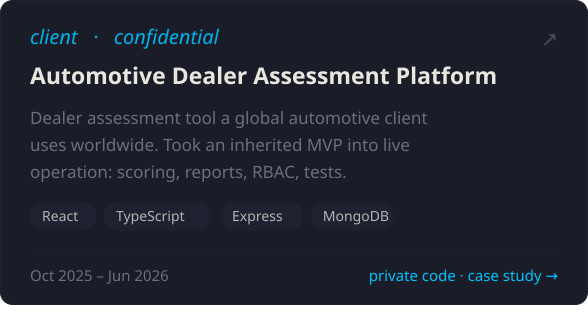</a>
  <a href="https://iamsanjeebandas.com/work/recipure">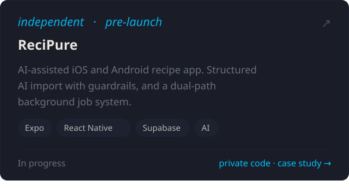</a>
  <a href="https://iamsanjeebandas.com/work/lchr-hr-platform">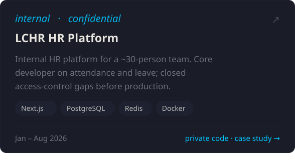</a>
  <a href="https://iamsanjeebandas.com/work/videocrew-portfolio">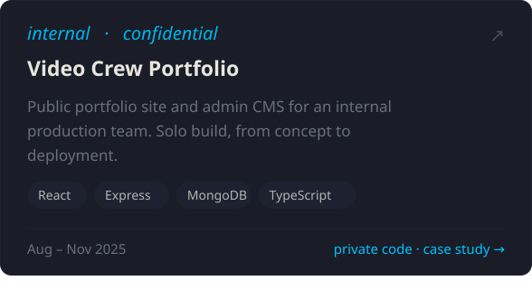</a>
  <a href="https://github.com/iamsanjeebandas/apartmnt">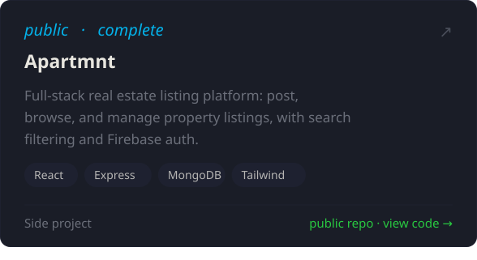</a>
  <a href="https://github.com/iamsanjeebandas/intellidoc-ai">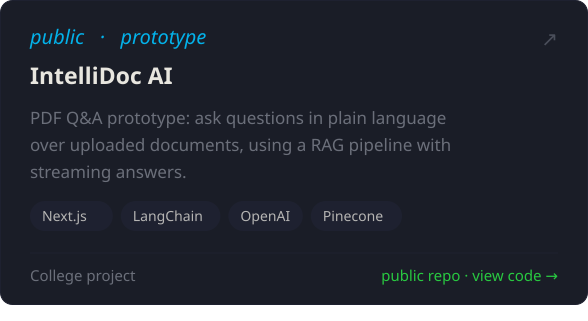</a>

 

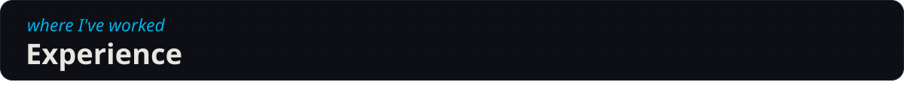

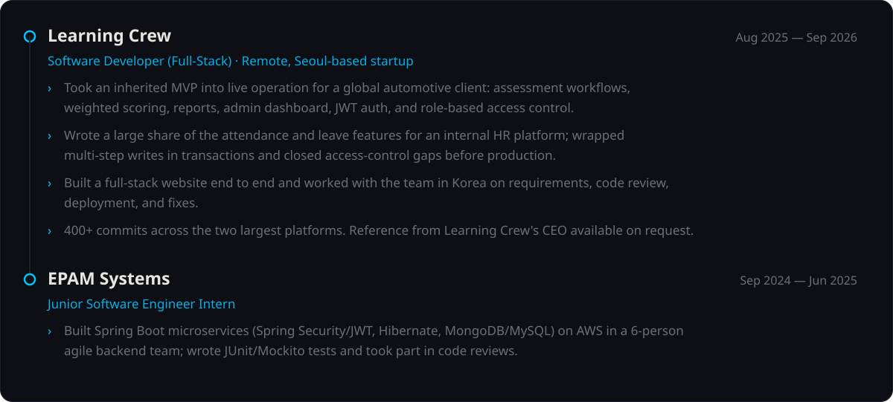

 

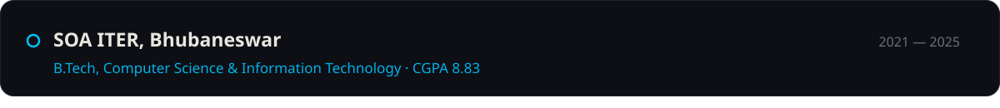

 

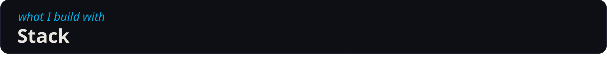

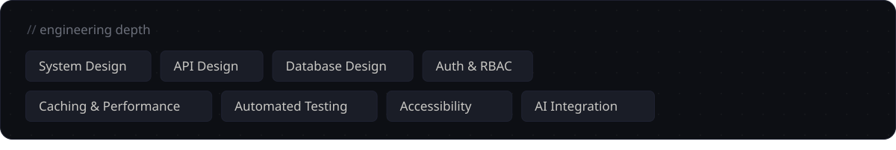

  

Also: React Native · Expo · TanStack Query · Supertest · JUnit · Mockito · Render · Sentry · OpenAI API · LangChain · Pinecone · Claude Code · Cursor

  

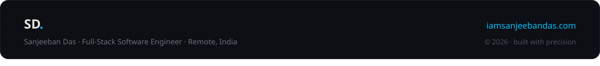

  
  
  
  

